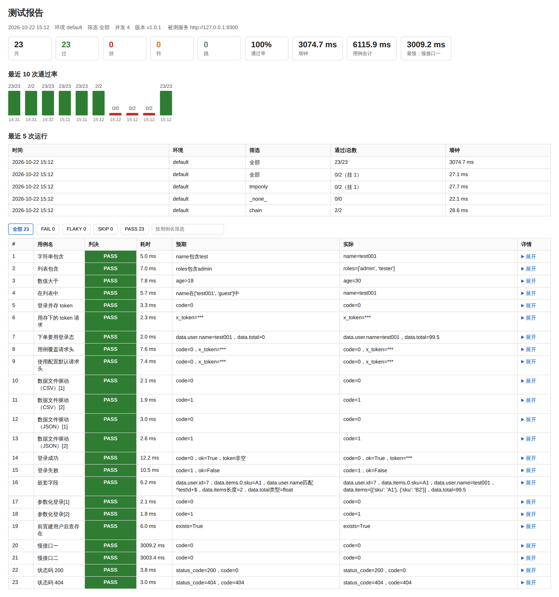

# mini-ui-autotest

[](https://github.com/Stefan3199/mini-ui-autotest/actions/workflows/test.yml)

一个从零实现的接口自动化测试框架（v1.0.1）。用例写在 YAML 里，跑一条命令，出 HTML 报告、机器可读结果和 JUnit。

名字里的 ui 是给后续 UI 自动化留的位置，v1.0.1 仍只做接口测试。

## 特性

**写用例**

- **YAML 数据驱动**：新增用例只改 YAML，不动代码
- **多条件断言**：一条用例可同时判多个字段，支持 `eq`、`not_null`、`contains`、`gt`、`in`、`regex`、`len`、`type`
- **嵌套字段**：`data.user.id`、`data.items.0.sku` 这种路径直接取，不用自己拆 JSON
- **状态码断言**：`status_code` 作为特殊字段，和响应体字段一起判
- **变量传递**：`save` 把响应字段存进上下文，后续用例用 `${token}` 引用；`${ENV:NAME}` 读环境变量
- **参数化**：一条用例配 `data` 列表，多组数据各跑一遍，名字带序号
- **数据文件驱动**：`data_file` 读 CSV 或 JSON，一行一组数据，CSV 的数值和布尔会自动转类型
- **用例依赖**：`depends_on` 声明前置用例，加载时查重名、查缺失、查成环，依赖链整条串行
- **前置后置**：用例可配 `setup` 和 `teardown` 请求列表，teardown 无论成败都执行
- **互斥组**：`group: 建用户` 让并发通道里同一组的用例排队跑，避免互相踩状态

**跑起来**

- **多环境**：`config/envs/<名字>.yaml` 只写差异，`--env test` 切过去，字典深合并
- **并发执行**：`--workers 4` 多线程跑，带 `save`、`${}`、依赖的用例自动分到串行通道
- **失败自动重试**：只重试环境抖动（连接、超时），业务失败不重试
- **失败重跑**：`--rerun 2` 让挂掉的用例再跑两轮，通过的标注重跑次数，不掩盖问题
- **只跑失败的**：`--only-failed` 下一轮只跑上次挂的和抖的
- **只列不跑**：`--list` 列出筛选后将要执行的用例，附通道、标签、串行原因
- **严格模式**：`--strict` 把用例里写错的字段名当错误，而不是悄悄忽略

**看结果**

- **判决四态 + 原因**：`PASS` / `FAIL` / `FLAKY` / `SKIP`，每个非 PASS 还带原因（断言、连接、超时、响应不是 JSON、依赖没过……）
- **HTML 报告**：总账、原因、耗时、趋势、筛选、请求详情、逐次尝试、断言明细
- **机器可读结果**：`report/result.json`，CI、看板、脚本直接消费
- **JUnit 报告**：`junit.xml`，Jenkins、GitLab、GitHub 都能读
- **语义化退出码**：0 全过 / 1 有挂 / 2 只有抖 / 3 用例或配置写错
- **报告归档**：每次运行存一份带时间戳的 HTML 到 `report/archive/`，保留份数可配
- **运行历史**：报告里带最近十次通过的柱状趋势

**可维护**

- **框架自测**：160 条单元测试，`python -m unittest` 直接跑，不依赖网络
- **分层结构**：用例加载、请求发送、断言、调度、报告各管一摊，`run.py` 只是薄壳
- **自动 CI**：push 或 PR 触发，4 个矩阵组合（3.10/3.13 × Ubuntu/Windows）

## 快速开始

要求 Python 3.10 及以上。

```bash
python -m venv .venv

# Windows
.venv\Scripts\activate
# macOS / Linux
source .venv/bin/activate

pip install -r requirements.txt
```

先起被测服务（仓库自带 demo）：

```bash
python demo/login_server.py
```

另开一个终端，跑测试：

```bash
python run.py
```

只跑冒烟组：

```bash
python run.py --tag smoke
```

切环境和开并发：

```bash
python run.py --env test
python run.py --workers 4
python run.py --tag slow --workers 2
```

上一轮有挂的用例，只跑这些：

```bash
python run.py --only-failed
```

先看看筛选后会跑哪些用例，不发请求：

```bash
python run.py --list
python run.py --tag chain --list
```

挂了想再给一次机会，跑两轮重试：

```bash
python run.py --rerun 2
```

demo 里有个 `/flip` 接口，第一次请求返回失败，之后都正常；`/html` 和 `/broken` 返回非 JSON，用来试「响应不是 JSON」怎么判。

跑完打开 `report/report.html` 看报告。用了 `--env` 时报告落在该环境配的目录里。同目录还有 `result.json`（机器读）、`junit.xml`（CI 用）、`last-failed.json`（下一轮 `--only-failed` 用）和 `archive/`（历次快照）。

### 跑框架自己的测试

```bash
python -m unittest discover -s tests -t . -v
```

不需要起 demo 服务：网络相关的用例自己在随机端口起 stub 服务和 demo 服务。CI 里这一步先跑，几秒出结果。

## 配置

`config/config.yaml`：

```yaml
base_url: "http://127.0.0.1:9300"
report_dir: "report"
retry_count: 3
timeout: 5
archive_keep: 20
headers:
  X-Token: default-token
sensitive: [pwd, pass, token, auth, key, secret, cookie, session]
```

- `base_url`：被测服务地址
- `report_dir`：报告输出目录（生成物，已加入 .gitignore）
- `retry_count`：单条请求最多尝试次数（只对连接失败、超时生效，至少 1）
- `timeout`：单次请求超时秒数，写成 `[连接, 读取]` 可以分开；用例可覆盖
- `archive_keep`：归档保留份数，`--keep` 可临时覆盖
- `headers`：公共请求头，用例里的同名头会覆盖这里
- `sensitive`：键名里包含这些片段的值在报告里打码，参数和请求头共用一份

环境配置放在 `config/envs/<名字>.yaml`，只写和基础配置不一样的部分：

```yaml
report_dir: "report-test"
timeout: 10
```

`python run.py --env test` 会把这份覆盖上去，字典一层层合并，其余沿用 `config/config.yaml`。环境文件不存在时直接报错退出，不会悄悄用默认值跑。

## 用例格式

`case/login.yaml`：

```yaml
- name: 登录成功
  tags: [smoke, login]
  url: /login
  method: POST
  params:
    user: test001
    pwd: "right123"
  expect:
    - field: code
      op: eq
      value: 0
    - field: ok
      op: eq
      value: true
    - field: token
      op: not_null
```

字段说明：

| 字段 | 必填 | 说明 |
|---|---|---|
| `name` | 是 | 用例名，报告里显示，也是 `depends_on` 引用的名字 |
| `url` | 是 | 接口路径，和 `base_url` 拼成完整地址；写完整 URL 则原样使用 |
| `method` | 是 | `GET`、`POST`、`PUT`、`PATCH`、`DELETE`、`HEAD`、`OPTIONS` |
| `expect` | 是 | 断言列表，全部命中才算 PASS |
| `params` | 否 | 请求参数。GET 类拼在 query，其余方法作为 JSON body |
| `headers` | 否 | 用例级请求头，同名覆盖配置 |
| `timeout` | 否 | 覆盖配置里的超时 |
| `tags` | 否 | 标签列表，供 `--tag` 筛选 |
| `save` | 否 | 把响应字段存进上下文，写成 `变量名: 字段路径`，只在 PASS 后写 |
| `data` | 否 | 参数化数据列表，每行一组变量 |
| `data_file` | 否 | CSV 或 JSON 数据文件，和 `data` 二选一 |
| `depends_on` | 否 | 前置用例名（或列表），上游没过本用例判 SKIP |
| `serial` | 否 | 写 `true` 时固定走串行通道 |
| `group` | 否 | 互斥组名，同组的用例在并发通道里不会同时跑 |
| `sensitive` | 否 | 额外要打码的键名 |
| `setup` / `teardown` | 否 | 前置/后置请求列表，每步要有 `name`、`url`、`method` |

写错字段名默认给提示（stderr），加 `--strict` 直接报错。`op` 写错一律在加载阶段报错，不会跑到一半才发现。

### 断言类型

| op | 说明 |
|---|---|
| `eq` | 字段值与 `value` 相等 |
| `not_null` | 字段存在且不为 `None` 或空字符串 |
| `contains` | 实际值包含 `value`，字符串看子串，列表看元素 |
| `gt` | 实际值大于 `value`，只对数字 |
| `in` | 实际值在 `value` 列表里 |
| `regex` | 实际值（字符串）能匹配 `value` 里的正则 |
| `len` | 实际值长度等于 `value`，字符串、列表、字典都行 |
| `type` | 实际值类型等于 `value`，可选 `str`、`int`、`float`、`bool`、`list`、`dict`、`null` |

字段名支持点号路径，`data.user.id` 取嵌套对象，`data.items.0.sku` 用数字取列表元素。

```yaml
- name: 用户信息
  tags: [assertion]
  url: /user
  method: GET
  params: {}
  expect:
    - field: status_code
      op: eq
      value: 200
    - field: roles
      op: contains
      value: admin
    - field: age
      op: gt
      value: 18
    - field: name
      op: in
      value: ["test001", "guest"]
```

`status_code` 是特殊字段，判的是 HTTP 状态码；其他字段都从响应 JSON 里取。

### 变量传递

前一条用例存，后一条用例用：

```yaml
- name: 登录并存 token
  url: /login
  method: POST
  params: {user: test001, pwd: "right123"}
  save:
    token: token
  expect:
    - field: code
      op: eq
      value: 0

- name: 用存下的 token 请求
  url: /echo
  method: GET
  params: {}
  headers:
    X-Token: "${token}"
  expect:
    - field: x_token
      op: eq
      value: "${token}"
```

`${token}` 整个就是一个变量时保留原类型，夹在文字里就转成字符串。变量没定义直接判 FAIL，不会按字面量发出去。

环境变量用 `${ENV:NAME}`，取不到同样直接判 FAIL。只用 `${ENV:...}` 的用例不算有依赖，仍然可以并发跑；密钥这类东西放环境变量，别写进 YAML。

### 参数化

一条用例配多组数据，`data` 里的每一行是一组变量：

```yaml
- name: 参数化登录
  url: /login
  method: POST
  data:
    - {user: test001, pwd: "right123", want: 0}
    - {user: test001, pwd: "wrong", want: 1}
  params:
    user: "${user}"
    pwd: "${pwd}"
  expect:
    - field: code
      op: eq
      value: "${want}"
```

报告里会显示成 `参数化登录[1]`、`参数化登录[2]`，哪一组挂了能直接定位。参数化和 `setup`/`teardown` 可以一起用，每一组各跑各的前置。

### 数据文件

数据行也可以放在外部文件里，CSV 用表头当变量名：

```csv
user,pwd,want
test001,right123,0
test001,wrong,1
```

```yaml
- name: 数据文件驱动（CSV）
  url: /login
  method: POST
  data_file: case/data/login.csv
  params:
    user: "${user}"
    pwd: "${pwd}"
  expect:
    - field: code
      op: eq
      value: "${want}"
```

JSON 写成对象数组，类型原样保留：

```json
[
  {"user": "test001", "pwd": "right123", "want": 0},
  {"user": "test001", "pwd": "wrong", "want": 1}
]
```

CSV 里全是字符串，读进来会按内容转一次：`true` / `false` 转布尔，纯数字转整数，带小数点的转浮点，其余保留字符串（首尾空白会被去掉）。`data` 和 `data_file` 只能给一个，两个都写会直接报错。

### 前置与后置

```yaml
- name: 前置建用户后查存在
  setup:
    - name: 建临时用户
      url: /admin/user
      method: POST
      params: {user: tmp001}
  teardown:
    - name: 删临时用户
      url: /admin/user/delete
      method: POST
      params: {user: tmp001}
  url: /admin/user/get
  method: GET
  params: {user: tmp001}
  expect:
    - field: exists
      op: eq
      value: true
```

setup 里任何一步拿不到响应，这条用例直接判 FAIL，主请求不发；teardown 不管主请求成败都会跑，它失败也判 FAIL，因为环境没清干净会污染后面的用例。

### 依赖

变量传递靠顺序，顺序靠文件顺序，改个文件名就可能断。`depends_on` 把这件事写到明面上：

```yaml
- name: 下单要用登录态
  depends_on: [登录并存 token]
  url: /order
  method: GET
  headers:
    X-Token: "${token}"
  expect:
    - field: code
      op: eq
      value: 0
```

加载时按依赖做拓扑排序，用例在报告里的位置就是执行顺序，跟文件名无关。同时查三件事：名字重没重、依赖的用例在不在、依赖有没有成环。三种错误都在加载阶段报出来。

依赖链整条进串行通道，因为被依赖的用例如果留在并发通道里，`${token}` 可能拿到空值。

上游没通过，下游判 `SKIP`，原因写「依赖 X 未通过」。SKIP 是没跑，不是跑挂了，所以不计入失败数，`--only-failed` 也不会把它当成失败去重跑。

按标签筛选时，选中用例的依赖会自动带进来，命令行会说明补了哪几条：

```
筛选标签：depend，共1条
按标签 depend 筛选，补上依赖 1 条：登录并存 token
```

### 并发与互斥组

`--workers 4` 开四个线程。带 `save`、引用了 `${}`、属于依赖链的用例会自动分到串行通道，避免后一条拿到空 token；其余并发跑，报告仍按用例原始顺序排。

并发适合只读接口。会改服务端共享状态、但彼此不依赖的用例（比如两条都在建用户），用 `group` 声明互斥：

```yaml
- name: 并发建用户 A
  group: 建用户
  url: /admin/user
  method: POST
  params: {user: a}
  expect: [{field: code, op: eq, value: 0}]

- name: 并发建用户 B
  group: 建用户
  url: /admin/user
  method: POST
  params: {user: b}
  expect: [{field: code, op: eq, value: 0}]
```

同组的用例在并发通道里排队执行，不同组之间照常并发。`serial: true` 是更粗的兜底：整条用例直接进串行通道。

`--list` 会把每条用例的通道和串行原因一起列出来，不用猜：

```
登录并存 token  [串行]  标签 v05,chain  （save 变量）
用存下的 token 请求  [串行]  标签 v05,chain  （引用 ${token}）
使用配置默认请求头  [并发]  标签 header
```

## 判决与原因

判决是四态，原因（cause）是第二个维度，两者一起写在报告和 `result.json` 里：

| 情况 | 判决 | 原因 | 重试 |
|---|---|---|---|
| 断言全部命中 | `PASS` | — | — |
| 断言没中 | `FAIL` | 断言未通过 | 不重试 |
| 有响应，但响应体断不了 | `FAIL` | 响应不是 JSON | 不重试 |
| 连接被拒、DNS 失败、连接超时 | `FLAKY` | 连接失败 | 重试 |
| 读取超时 | `FLAKY` | 请求超时 | 重试 |
| 其他传输错误 | `FLAKY` | 传输失败 | 重试 |
| 变量没定义 | `FAIL` | 变量未定义 | 不重试 |
| setup 失败 | `FAIL` | 前置失败 | 不重试 |
| teardown 失败 | `FAIL` | 后置失败 | 不重试 |
| 依赖的用例没过 | `SKIP` | 依赖未通过 | 不重试 |

为什么分这么细：

- `FAIL` 是接口回了但不对，要改代码或改断言；`FLAKY` 是根本没拿到响应，先看环境。混成一个红叉，CI 上就没法判断该找谁。
- 响应不是 JSON 单独成一类：接口挂了返回 HTML 错误页、网关返回空 body，都是真实故障，不该记成「环境抖动」。这类响应里**只涉及状态码的断言仍然有效**——判状态码 404 的用例照样能过。
- 重试只服务环境抖动。断言没中重试一万次也不会变绿，只会把问题藏起来。

重跑通过的用例仍显示 `PASS`，下面标一行「重跑 N 轮后通过」，顶部总账单独给出重跑通过几条，不算假绿。

## 命令行

| 参数 | 说明 |
|---|---|
| `--tag <标签>` | 只跑带这个标签的用例，依赖自动带入 |
| `--env <名字>` | 读 `config/envs/<名字>.yaml` 覆盖基础配置 |
| `--workers <N>` | 并发线程数，默认 1 |
| `--only-failed` | 只跑上次挂的和抖的 |
| `--rerun <N>` | 失败用例最多再跑 N 轮，默认 0 |
| `--list` | 只列出将要执行的用例，不发请求 |
| `--strict` | 用例里的未知字段直接报错 |
| `--keep <N>` | 归档保留份数，覆盖配置 |
| `--open` | 跑完直接打开报告 |
| `--quiet` / `--verbose` | 少打印 / 打印每次请求尝试 |
| `--version` | 打印版本 |

退出码：

| 码 | 含义 |
|---|---|
| `0` | 全过（含 SKIP） |
| `1` | 有 `FAIL` |
| `2` | 没有 FAIL，但有 `FLAKY` |
| `3` | 用例、配置或参数写错了（含环境文件不存在、YAML 语法错、`data_file` 缺失、`--only-failed` 但没有上一次结果） |

CI 看退出码，别去解析屏幕输出。

## 报告与产物

报告目录里有六份东西：

- `report.html`：给人看的。顶部总账（共/过/挂/抖/跳、通过率、墙钟、用例合计、最慢）、最近十次通过率的柱状趋势、最近五次运行、可按判决和名字筛选的用例表。每条用例可展开看请求方法、地址、状态码、参数、请求头、存下的变量、失败原因、每次请求尝试、逐条断言结果。
- `result.json`：给机器看的。`meta`（版本、环境、筛选、并发、被测地址、耗时）、`summary`（各项计数）、`cases`（每条用例的判决、原因、耗时、每次尝试、逐条断言）。
- `junit.xml`：`FAIL` 记 `failure`，`FLAKY` 记 `error`，`SKIP` 记 `skipped`，重跑通过的写 `system-out`。
- `last-failed.json`：这一轮挂的和抖的用例名，`--only-failed` 读它。按环境隔离。
- `history.json`：最近 20 次运行的总账，趋势图的数据源。
- `archive/`：每次运行的 HTML 快照，文件名带时间和筛选条件，只留最近 `archive_keep` 份。

报告里的参数和请求头在记账时脱敏：键名含 `pwd`、`pass`、`token`、`auth`、`key`、`secret`、`cookie`、`session` 的值替换成 `***`，参数和请求头用同一套规则（v0.9 里参数只认 `pwd`/`pass`，是一条不一致）。

23 条用例全绿时长这样（`--workers 4`）：



## 项目结构

```
mini-ui-autotest/
├── .github/
│   └── workflows/
│       └── test.yml       # 单测矩阵 + demo 端到端
├── case/                  # 用例
│   └── data/              # 数据文件：login.csv、login.json
├── config/                # 配置
│   └── envs/              # 环境覆盖：dev、test
├── demo/                  # 被测 demo 服务
├── docs/
│   └── images/            # README 截图
├── engine/
│   ├── __init__.py        # 版本号
│   ├── case_loader.py     # 读配置和用例，校验、合并、展开、排依赖、拼请求
│   ├── request_sender.py  # 发请求，传输错误与协议错误分开抛
│   ├── assertion.py       # 断言算子表，含嵌套字段取值
│   ├── variables.py       # 变量替换 ${name} / ${ENV:NAME}
│   ├── masking.py         # 参数和请求头的脱敏
│   ├── result.py          # 判决、原因、尝试、用例结果的数据模型
│   ├── runner.py          # 调度：单条、串行/并发通道、重跑
│   ├── report.py          # HTML、JUnit、result.json、历史、归档
│   └── cli.py             # 参数解析、组装、退出码
├── templates/
│   └── report.html        # 报告模板
├── tests/                 # 框架自测（160 条）
├── run.py                 # 入口薄壳：from engine.cli import main
├── requirements.txt
├── CHANGELOG.md
├── README.md
└── LICENSE
```

## 持续集成

推送到 main 或开 PR 时，GitHub Actions 会跑两个任务：

1. **框架自测**：3.10 / 3.13 × Ubuntu / Windows，四个组合跑 `python -m unittest`
2. **端到端**：同样的矩阵，起 demo 服务，跑 `python run.py --workers 4`，上传报告

工作流文件：`.github/workflows/test.yml`。

## 设计说明

**分层与依赖**

- `run.py` 只是薄壳，逻辑在 `engine/cli.py`；`import run` 不会执行任何东西，所以测试能直接调 `cli.main(argv)`。
- 模块之间单向依赖：`cli` → `runner`/`report`/`case_loader`，`case_loader` → `assertion`/`variables`/`masking`/`request_sender`。唯一的「底层互相看」是 loader 用断言层的算子表做校验——一张表比两份清单可靠。
- 数据在层与层之间只有两种形状：用例是 dict，结果是 `Outcome`。没有第三套模型。

**判决**

- 判决定四态而不是两态：`FAIL` 是接口回了但断言没中，`FLAKY` 是根本没拿到响应，`SKIP` 是没跑。三者处置人不同。
- `FAIL` 之外再带 cause：连接失败、请求超时、响应不是 JSON、变量未定义、前置失败、后置失败、依赖未通过。报告能直接说清「为什么」。
- 传输错误和协议错误分开抛：`send_case` 成功返回 `Response`，失败抛 `TransportError`（可重试）或 `ProtocolError`（不重试）。v0.9 只返回 `None`，把「连不上」「返回的不是 JSON」「超时」压成同一个 FLAKY；而且 `requests` 的 `JSONDecodeError` 继承自 `RequestException`，会连非 JSON 响应一起吞掉，导致状态码断言永远拿不到响应。
- 非 JSON 响应保留状态码，body 当空：只断状态码的用例照样过；一旦断言碰到响应体字段，判 `FAIL` 且原因是「响应不是 JSON」，不记抖动。
- 重试只服务连接层。断言失败不重试，重试一万次也不会变绿。

**输入**

- `prepare` 是纯函数：返回新字典，不改入参，URL 拼接幂等。所以同一条用例被处理两次也不会拼出 `http://ahttp://a/echo`。
- 展开参数化用 `deepcopy`：每条数据行各持有自己的 `setup`/`teardown`，不共享可变对象。
- 加载期做校验：必填字段、方法白名单、op 白名单、`data`/`data_file` 互斥、依赖重名/缺失/成环。错误信息带文件名、第几条、哪条断言。
- 未知字段默认提示、`--strict` 报错；未知 op 一律报错。写错用例不应该表现成「断言没中」。

**调度**

- 依赖用拓扑排序定顺序，不靠文件名字典序；顺带把重名、缺失、成环挡在加载阶段。
- 依赖链整条进串行通道，否则被依赖的用例可能还在并发队列里。
- 强制串行的判定有三条：显式 `serial`、`save`、引用了非 `ENV:` 的 `${}`；依赖链会传播。`--list` 会说清是哪一条。
- 串行通道共享上下文和已完成结果；并发通道每线程独立，靠 `group` 做互斥。
- 重跑只碰 `FAIL`：串行通道整条按原顺序重跑（变量接得上），并发通道只跑挂的那几条。重跑通过单独计数并标注，不改判。
- 并发用线程不用进程：用例都在等网络，GIL 不是瓶颈；进程池还要处理 Windows 的启动守卫和结果序列化。

**输出**

- 三份产物（HTML、JUnit、result.json）从同一批 `Outcome` 派生，不会互相打架。
- 脱敏只有一份规则，参数和请求头共用；`sensitive` 可以按配置或用例追加。
- 报告里的墙钟耗时和用例耗时合计分开列，并发时两个数差多少就知道省了多少。
- 归档按文件名里的时间戳排序，只留最近 `archive_keep` 份。
- 退出码分四档，CI 不用解析输出。
- 标准输出在被重定向或进 CI 时切 UTF-8，避免 Windows 上中文变乱码。

## 从 v0.9 升级

现有 23 条用例一行没改，YAML 格式向后兼容。需要知道的六处行为变化：

1. **非 JSON 响应不再算 FLAKY**：现在判 `FAIL`（原因「响应不是 JSON」）；只断言状态码时仍然 `PASS`。
2. **未知 op 在加载期报错**：v0.9 是静默判 FAIL（报告上写「期望 ?」）。未知字段默认提示，`--strict` 报错。
3. **脱敏范围统一**：参数也按 `token`/`auth`/`key` 等打码，v0.9 只有 `pwd`/`pass`。
4. **参数化 + setup 不再互相污染**：v0.9 用浅拷贝，两行数据共享前置列表，URL 会被拼两遍。
5. **只用 `${ENV:...}` 的用例可以并发**：v0.9 里任何 `${` 都强制串行。
6. **退出码细分**：有 `FAIL` = 1，只有 `FLAKY` = 2，用例/配置/参数错误 = 3（v0.9 一律 1）。

另外新增：`group` 互斥组、`sensitive`、`${ENV:NAME}`、`PUT`/`PATCH`/`DELETE`/`HEAD`/`OPTIONS`、`result.json`、原因列、尝试明细、报告筛选。完整清单见 [CHANGELOG.md](CHANGELOG.md)。

## Roadmap

- v0.2（已完成）：headers、timeout、标签筛选
- v0.3（已完成）：状态码断言、contains、gt、in
- v0.4（已完成）：GitHub Actions 持续集成
- v0.5（已完成）：嵌套字段、regex/len/type、变量传递、参数化、耗时统计
- v0.6（已完成）：多环境、setup/teardown、并发执行
- v0.7（已完成）：外部数据文件、只跑失败用例、运行历史
- v0.8（已完成）：JUnit 报告、失败重跑、报告归档、--list
- v0.9（已完成）：用例依赖 depends_on、SKIP 判决、通过率趋势图
- v1.0（已完成）：判决原因、传输/协议错误分离、框架自测、result.json、互斥组、语义化退出码
- v1.0.1（已完成）：敏感值脱敏、子目录用例、超时校验等 8 个修复
- 远期：Playwright UI 自动化

## License

MIT
