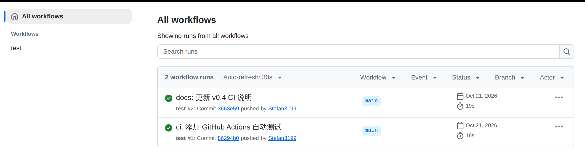

# mini-ui-autotest

[](https://github.com/Stefan3199/mini-ui-autotest/actions/workflows/test.yml)

一个从零实现的接口自动化测试框架（v0.6）。用例写在 YAML 里，跑一条命令，出 HTML 报告。

名字里的 ui 是给后续 UI 自动化留的位置，v0.6 仍只做接口测试。

## 特性

- **YAML 数据驱动**：新增用例只改 YAML，不动代码
- **多条件断言**：一条用例可同时判多个字段，支持 `eq`、`not_null`、`contains`、`gt`、`in`、`regex`、`len`、`type`
- **嵌套字段**：`data.user.id`、`data.items.0.sku` 这种路径直接取，不用自己拆 JSON
- **状态码断言**：`status_code` 作为特殊字段，和响应体字段一起判
- **失败自动重试**：只重试环境抖动，抖动与真失败分账
- **变量传递**：`save` 把响应字段存进上下文，后续用例用 `${token}` 引用
- **参数化**：一条用例配 `data` 列表，多组数据各跑一遍，名字带序号
- **请求头**：配置写公共头，用例可覆盖，报告里自动打码
- **超时控制**：配置默认超时，用例可覆盖，超时记 FLAKY 不误判 FAIL
- **标签筛选**：用例打 tags，命令行 `--tag` 只跑一组
- **耗时统计**：每条用例计时，报告给出总耗时和最慢用例
- **多环境**：`config/envs/<名字>.yaml` 只写差异，`--env test` 切过去，字典深合并
- **前置后置**：用例可配 `setup` 和 `teardown` 请求列表，teardown 无论成败都执行
- **并发执行**：`--workers 4` 多线程跑，带 `save` 或 `${}` 的用例自动分到串行通道
- **HTML 报告**：总账、判决、耗时、预期与实际对比、请求详情、逐条断言结果
- **自动 CI**：push 或 PR 触发 GitHub Actions，跑测试并上传报告
- **分层结构**：用例加载、请求发送、断言、调度各管一摊

## 快速开始

要求 Python 3.10 及以上。

```bash
python -m venv .venv

# Windows
.venv\Scripts\activate
# macOS / Linux
source .venv/bin/activate

pip install -r requirements.txt
```

先起被测服务（仓库自带 demo）：

```bash
python demo/login_server.py
```

另开一个终端，跑测试：

```bash
python run.py
```

只跑冒烟组：

```bash
python run.py --tag smoke
```

切环境和开并发：

```bash
python run.py --env test
python run.py --workers 4
python run.py --tag slow --workers 2
```

打开 `report/report.html` 看报告，用了 `--env` 时报告落在该环境配的目录里。

## 配置

`config/config.yaml`：

```yaml
base_url: http://127.0.0.1:9300
report_dir: report
retry_count: 3
timeout: 5
headers:
  X-Token: default-token
```

- `base_url`：被测服务地址
- `report_dir`：报告输出目录（生成物，已加入 .gitignore）
- `retry_count`：单条用例最多尝试次数
- `timeout`：单次请求超时秒数，用例可覆盖
- `headers`：公共请求头，用例里的同名头会覆盖这里

环境配置放在 `config/envs/<名字>.yaml`，只写和基础配置不一样的部分：

```yaml
report_dir: "report-test"
timeout: 10
```

`python run.py --env test` 会把这份覆盖上去，字典一层层合并，其余沿用 `config/config.yaml`。环境文件不存在时直接报错退出，不会悄悄用默认值跑。

## 用例格式

`case/login.yaml`：

```yaml
- name: 登录成功
  tags: [smoke, login]
  url: /login
  method: POST
  params:
    user: test001
    pwd: "right123"
  expect:
    - field: code
      op: eq
      value: 0
    - field: ok
      op: eq
      value: true
    - field: token
      op: not_null
```

字段说明：

- `name`：用例名，报告里显示
- `tags`：可选，标签列表，供 `--tag` 筛选
- `url`：接口路径，和 config.base_url 拼成完整地址
- `method`：GET 或 POST
- `headers`：可选，用例级请求头，同名覆盖配置
- `params`：请求参数
- `save`：可选，把响应字段存进上下文，写成 `变量名: 字段路径`
- `data`：可选，参数化数据列表，每行一组变量，用例按行展开
- `setup`：可选，前置请求列表，发主请求之前逐条跑
- `teardown`：可选，后置请求列表，主请求之后必跑
- `expect`：断言列表，全部命中才算 PASS

### 断言类型

- `eq`：字段值与 `value` 相等
- `not_null`：字段存在且不为 `None` 或空字符串
- `contains`：实际值包含 `value`，字符串看子串，列表看元素
- `gt`：实际值大于 `value`，只对数字
- `in`：实际值在 `value` 列表里
- `regex`：实际值（字符串）能匹配 `value` 里的正则
- `len`：实际值长度等于 `value`，字符串、列表、字典都行
- `type`：实际值类型等于 `value`，可选 `str`、`int`、`float`、`bool`、`list`、`dict`、`null`

字段名支持点号路径，`data.user.id` 取嵌套对象，`data.items.0.sku` 用数字取列表元素。

### 更多断言示例

```yaml
- name: 用户信息
  tags: [assertion]
  url: /user
  method: GET
  params: {}
  expect:
    - field: status_code
      op: eq
      value: 200
    - field: roles
      op: contains
      value: admin
    - field: age
      op: gt
      value: 18
    - field: name
      op: in
      value: ["test001", "guest"]
```

`status_code` 是特殊字段，判的是 HTTP 状态码；其他字段都从响应 JSON 里取。

### 变量传递

前一条用例存，后一条用例用：

```yaml
- name: 登录并存 token
  url: /login
  method: POST
  params: {user: test001, pwd: "right123"}
  save:
    token: token
  expect:
    - field: code
      op: eq
      value: 0

- name: 用存下的 token 请求
  url: /echo
  method: GET
  params: {}
  headers:
    X-Token: "${token}"
  expect:
    - field: x_token
      op: eq
      value: "${token}"
```

`${token}` 整个就是一个变量时保留原类型，夹在文字里就转成字符串。变量没定义直接判 FAIL，不会按字面量发出去。

### 参数化

一条用例配多组数据，`data` 里的每一行是一组变量：

```yaml
- name: 参数化登录
  url: /login
  method: POST
  data:
    - {user: test001, pwd: "right123", want: 0}
    - {user: test001, pwd: "wrong", want: 1}
  params:
    user: "${user}"
    pwd: "${pwd}"
  expect:
    - field: code
      op: eq
      value: "${want}"
```

报告里会显示成 `参数化登录[1]`、`参数化登录[2]`，哪一组挂了能直接定位。

### 前置与后置

```yaml
- name: 前置建用户后查存在
  setup:
    - name: 建临时用户
      url: /admin/user
      method: POST
      params: {user: tmp001}
  teardown:
    - name: 删临时用户
      url: /admin/user/delete
      method: POST
      params: {user: tmp001}
  url: /admin/user/get
  method: GET
  params: {user: tmp001}
  expect:
    - field: exists
      op: eq
      value: true
```

setup 里任何一步没拿到响应，这条用例直接判 FAIL，主请求不发；teardown 不管主请求成败都会跑，它失败也判 FAIL，因为环境没清干净会污染后面的用例。

### 并发

`--workers 4` 开四个线程。带 `save` 或者引用了 `${}` 的用例会自动分到串行通道，避免后一条拿到空 token；其余并发跑，报告仍按用例原始顺序排。

并发适合只读接口。会改服务端共享状态的用例（比如建用户、删用户）建议单独用 `--tag` 串行跑，自动识别只处理变量依赖，管不了服务端数据。

## 报告

报告是单个 HTML 文件，包含：

- 顶部总账：共几条，过、挂、抖各几条，墙钟总耗时和用例耗时合计，最慢用例，当前筛选、环境、并发数
- 每条用例：名字、判决、耗时、预期摘要、实际摘要
- 详情折叠：请求方法、地址、参数、请求头、存下的变量，失败原因，逐条断言结果

判决三态：

- `PASS`：全部断言命中
- `FAIL`：有断言没中
- `FLAKY`：重试次数用完仍没拿到响应，属于环境抖动，不算业务失败

18 条用例全绿时长这样：


## 持续集成

推送到 main 或开 PR 时，GitHub Actions 会自动：

1. 安装依赖
2. 启动 demo 被测服务
3. 跑全部用例
4. 上传 HTML 报告作为 artifact

用例有 `FAIL` 或 `FLAKY` 时，进程返回 1，流水线标红。报告在 Actions 运行页的 Artifacts 里下载。

工作流文件：`.github/workflows/test.yml`。

运行记录：



## 项目结构

```
mini-ui-autotest/
├── .github/
│   └── workflows/
│       └── test.yml       # GitHub Actions 工作流
├── case/                  # 用例
├── config/                # 配置
│   └── envs/              # 环境覆盖：dev、test
├── demo/                  # 被测 demo 服务
├── docs/
│   └── images/            # README 截图
├── engine/
│   ├── case_loader.py     # 读配置和用例，补齐 URL、请求头、超时，展开参数化
│   ├── request_sender.py  # 发请求，返回状态码和响应体
│   ├── assertion.py       # 断言引擎，含嵌套字段取值
│   └── variables.py       # 变量替换 ${name}
├── templates/
│   └── report.html        # 报告模板
├── run.py                 # 入口：筛选、调度、重试、记账、出报告
├── requirements.txt
├── README.md
└── LICENSE
```

## 设计说明

- 模块之间不互相 import，组装放在 `run.py`，避免包模式和脚本模式两套路径打架。
- `case_loader` 负责把用例加工成能直接发的样子：拼完整 URL，合并配置公共头和用例头，注入超时。
- `request_sender` 返回 `{"status_code": ..., "body": ...}`，断言层普通字段走 `body`，状态码走外层。
- 重试只服务环境抖动：`send_case` 拿不到响应时返回 `None`，`run.py` 负责重试；业务失败不重试。
- 判决定三态而不是两态：`FAIL` 是接口回了但断言没中，`FLAKY` 是根本没拿到响应。
- 报告里的参数和请求头在记账时脱敏：键名含 `pwd`、`pass`、`token`、`auth`、`key` 的值替换成 `***`。
- 断言先出逐条结果表，判决和报告摘要都从这张表派生。
- 字段取值统一走 `pick`，点号拆路径，列表认数字下标，把嵌套和一层的写法合成一套。
- 变量替换只在发送前做一次，报告里存的是替换后的参数，请求头仍然打码。
- `save` 只在用例 PASS 后写上下文，失败用例的响应不能喂给后面的用例。
- 变量没定义直接判 FAIL，不按字面量发出去，否则预期和实际都是 `${token}`，会假绿。
- `type` 用 `type(actual) is want`，不用 `isinstance`：Python 里 `True` 也是 `int`，用 isinstance 判 int 会放过 bool。
- 环境文件只写差异，深合并，缺文件直接退出，避免环境名拼错还静默跑默认配置。
- setup 失败就不发主请求，teardown 一定执行，它失败也判 FAIL。
- 并发按依赖自动切通道，`save` 和 `${}` 是判定依据，不靠人工标注。
- 报告的墙钟耗时和用例耗时合计分开列，并发时两个数差多少就知道省了多少。
- CI 看退出码不看屏幕输出，用例有挂或抖时 `run.py` 返回 1。

## Roadmap

- v0.2（已完成）：headers、timeout、标签筛选
- v0.3（已完成）：状态码断言、contains、gt、in
- v0.4（已完成）：GitHub Actions 持续集成
- v0.5（已完成）：嵌套字段、regex/len/type、变量传递、参数化、耗时统计
- v0.6（已完成）：多环境、setup/teardown、并发执行
- 远期：Playwright UI 自动化

## License

MIT
